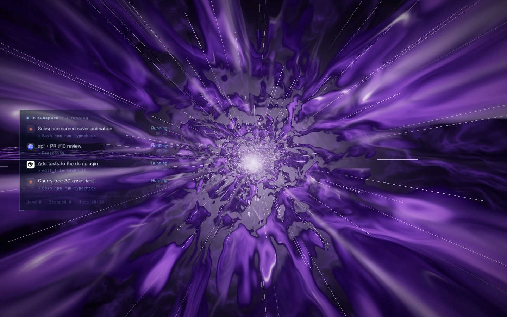
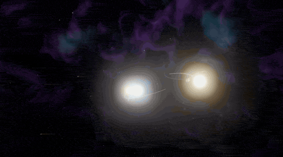
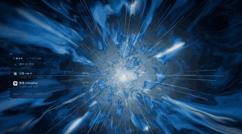
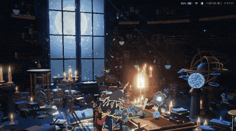
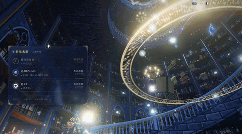
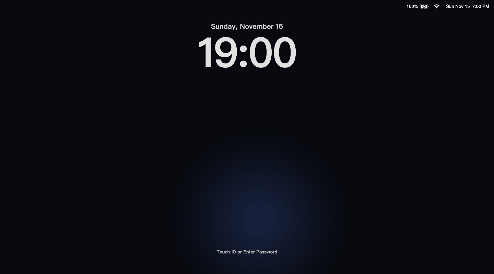
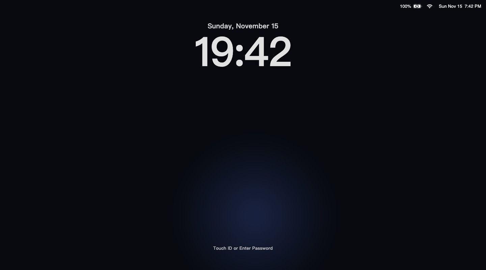

# dsh-screensaver: a macOS screen saver that keeps AI coding agents running while you're away

You step away for coffee, a meeting or lunch. Claude Code, Codex or DeepSeek Harness is still working, and you don't
want people reading your screen. dsh-screensaver covers it with a lock screen that looks like the Mac's own; touch
Touch ID to unlock when you're back. While it's up the Mac doesn't sleep, the display stays on, and it can stay awake
with the lid closed too. Themes can show each live **Claude Code**, **OpenAI Codex** and **DeepSeek Harness** session:
running, waiting for your approval, finished or stopped.

It is a [DeepSeek Harness](https://github.com/deepseek-ai/deepseek-harness) (dsh) plugin, and it also runs on its own
with `npx`.

[中文说明](README.zh-CN.md) · [llms.txt (summary for AI assistants)](llms.txt) · [Theme API](docs/themes.md) · [Theme skill](skills/dsh-screensaver-theme/SKILL.md) · [Visual assets license](LICENSE-ASSETS.md)



Subspace Jump and Arcane Study each have an idle scene for when nothing is running and a running scene for when your
agents are working, and switch between them by themselves. Each clip below is 3 s of one scene, the transition, then
5 s of the other. Clock is a macOS-style lock screen with no scenes: only the time moves.

| | Agents start: idle → running | Agents finish: running → idle |
| --- | --- | --- |
| **Subspace Jump**<br>`subspace` |  |  |
| **Arcane Study**<br>`magic-tower` |  |  |
| **Clock**<br>`basic` |  |  |

## Why not the macOS screen saver, the lock screen, or a wallpaper?

The lock screen and the system screen saver assume the Mac can rest once you leave. dsh-screensaver assumes your agents
keep working and you only want the screen covered.

| | macOS lock screen (⌃⌘Q) | macOS screen saver | Wallpaper / live wallpaper | `caffeinate` / Amphetamine | **dsh-screensaver** |
| --- | --- | --- | --- | --- | --- |
| Covers the screen from passers-by | Yes (real system lock) | Yes, until a key is pressed (lock only if "require password") | No | No | **Yes** (a cover, not a security boundary) |
| CLI agents in a terminal (Claude Code, Codex CLI, dsh) keep running | Yes | Yes | Yes | Yes | **Yes** |
| Computer-use agents and extension-driven browsers keep running | No, they stop ([openai/codex#58545](https://github.com/openai/codex/issues/58545), [openai/codex#43869](https://github.com/openai/codex/issues/43869)) | Not tested | Yes | Yes | **Browser-extension agents keep running**; anything that must click the screen is covered |
| Covered browser windows keep full speed | No, the system treats them as hidden | Not tested | n/a | n/a | **Yes**: the cover is a tiny bit translucent, so the system still treats windows as visible |
| Prevents display sleep and system idle sleep | No: the display soon goes dark, and whether the Mac then sleeps depends on other apps ([anthropics/claude-code#81832](https://github.com/anthropics/claude-code/issues/81832)) | No | No | Yes | **Yes, while it is up** |
| Stays awake with the **lid closed** | No | No | No | No (sleep assertions cannot stop lid sleep) | **Yes, on by default** once you allow it (`pmset disablesleep` with a one-time admin authorization, auto-restored) |
| Unlock | Touch ID or password | Key press (+ password) | n/a | n/a | **Just touch Touch ID**, or press any key / click and type the login password (Touch ID keeps working meanwhile) |
| Shows what your agents are doing | No | No | No | No | **Yes** (themes that opt in: names, current step, running / waiting / done / stopped) |

In a café or a shared office where you need real security and only run terminal agents, use ⌃⌘Q (run
`/screensaver lid on` first if you also want lid-closed awake). At home, or when you run computer-use or browser agents,
use dsh-screensaver.

> dsh-screensaver is **not a security boundary**: holding the power button still works, and it does not replace the
> macOS login. It keeps people walking by from reading your screen or typing into your agents.

## Install

### As a DeepSeek Harness plugin

```bash
dsh plugin --profile web add dsh-screensaver
```

Use `desktop` instead of `web` for the desktop app profile, then restart dsh. The first start downloads the Electron
runtime (about 100 MB, once) and compiles the Touch ID helper if the Xcode Command Line Tools are installed.

All three themes, Clock, Subspace Jump and Arcane Study, ship inside this package; there is nothing else to install.

Want the latest unreleased code from GitHub instead of the npm release:

```bash
dsh plugin --profile web add github:realRoc/dsh-screensaver
```

### Without dsh

```bash
npx dsh-screensaver --now               # cover the screen now, exit after you unlock
npx dsh-screensaver                     # stay in the background, press ⌃⌥⌘L to start
npx dsh-screensaver --now subspace      # with a theme
npx dsh-screensaver setup               # settings: lid-closed awake (and its one-time authorization), theme, idle start
```

Requirements: macOS 12 or later, Node.js 22 or later. Touch-to-unlock needs a Mac with Touch ID (or a Magic Keyboard with
Touch ID) and the Xcode Command Line Tools (`xcode-select --install`); without them the system Touch ID / password dialog
is used instead.

## Use

- **Start:** ⌃⌥⌘L (Control+Option+Command+L), `/screensaver` in dsh, or ask your agent ("I'm stepping away, cover the
  screen"); it calls the `screensaver` tool. You can also start it automatically after N idle minutes.
- **Unlock:** touch the Touch ID sensor. Pressing any key or clicking shows a password field at the bottom: type the login password and press Return. As on the macOS lock screen, Touch ID keeps working while the field is open. Esc or 30 seconds of inactivity hides it.
- **Pure mode:** after 30 seconds without input, the hint, the status bar and the session list fade out and only the
  animation is left. Moving the mouse, pressing a key or touching Touch ID brings them back.

| Command | What it does |
| --- | --- |
| `/screensaver` | Start with the default theme |
| `/screensaver <theme>` | Start with a theme, e.g. `/screensaver subspace` |
| `/screensaver <theme> <theme> …` | A theme per screen, main screen first, e.g. `/screensaver magic-tower subspace` |
| `/screensaver themes` | List installed themes |
| `/screensaver lid` | Show lid-closed awake status |
| `/screensaver lid authorize` | Allow lid-closed awake (asks for an admin password once; installs a sudoers rule that only allows `pmset -a disablesleep 0/1`) |
| `/screensaver lid on` / `off` | Turn lid-closed awake on or off by hand |
| `/screensaver lid revoke` | Remove the sudoers rule |

### Configuration

Add an entry to your profile's `~/.dsh/profiles/<profile>/cordis.patch.yml` (it replaces the whole config block):

```yaml
- id: dsh-screensaver
  config:
    theme: subspace      # default theme id
    screens: [magic-tower, subspace]   # optional: a theme per screen (see "Several screens" below)
    idleMinutes: 10      # start after 10 idle minutes; 0 = never (default)
    lidAwake: true       # keep the Mac awake with the lid closed while the screen saver is up (default; false turns it off)
    shortcut: Control+Alt+Command+L   # Electron accelerator; '' disables the shortcut
```

Standalone, the same fields live in `~/.dsh/plugins-data/dsh-screensaver/config.json`:

| Command | What it does |
| --- | --- |
| `dsh-screensaver setup` | Walk through lid-closed awake (authorizes it on the spot), the theme, a theme per screen and idle start |
| `dsh-screensaver config` | Show the settings and the file they are saved in |
| `dsh-screensaver config <key> <value>` | Change one, e.g. `config lidAwake off`, `config idleMinutes 10`, `config screens magic-tower,subspace` |
| `dsh-screensaver config unset <key>` | Back to the default |
| `dsh-screensaver lid [status\|authorize\|revoke]` | Lid-closed awake authorization, same as `/screensaver lid` |
| `dsh-screensaver themes` | List installed themes |

`DSH_SCREENSAVER_CONFIG='{"theme":"subspace"}'` overrides the file for one run. A `--now` handed to a screen saver that is
already running (for example the one inside dsh) brings its `lidAwake` and `screens` along for that start when it sets them (in the file or the variable); otherwise the running one
uses its own config.

### Several screens

Every screen gets the same theme unless you set `screens`: a list of theme ids, one per screen. The first is the main
screen (the one with the menu bar), the rest go to the other screens from left to right (top to bottom when two share a
column), and screens beyond the end of the list use its last entry. `[magic-tower, subspace]` puts Arcane Study on the
main screen and Subspace Jump on every other one; `[magic-tower, subspace, basic]` gives a third screen the clock. A
screen plugged in while the screen saver is up gets its theme the same way. Naming one theme for a single start
(`--now subspace`, `/screensaver subspace`) uses it on every screen that time.

## Themes

| Theme | id | Ships with | Shows agent sessions |
| --- | --- | --- | --- |
| Clock | `basic` | built in | No |
| Subspace Jump | `subspace` | built in | Yes |
| Arcane Study | `magic-tower` | built in | Yes |

- **Subspace Jump**: three suns orbit in normal space; while agents run, the camera jumps into a warp tunnel that drifts
  between a nebula storm, a vortex of ocean waves and a tunnel of Gaussian splats.
- **Arcane Study**: an HD-2D pixel scene. A knight reads by moonlight in a tower study; while agents run, the camera
  dives into the book and the knight climbs the tower. Sessions are listed on a rune ledger, and the theme draws its own
  status bar (with tonight's moon phase) and Touch ID ring in the same places as the shell.

In every theme the session list is on the left, the date and time at the top right and the Touch ID hint at the bottom
centre, and all of them fade out after 30 s without input, leaving only the scene.

Themes are visual works licensed CC BY-NC-SA 4.0 (no commercial use). A theme is a folder with an `index.html` (runs in a sandboxed iframe, draws only) and a
`saver.json`. Put your own in `~/.dsh/plugins-data/dsh-screensaver/themes/<id>/`, or publish it as an npm package with
`"dsh-screensaver": { "theme": "." }` in its `package.json`. See [docs/themes.md](docs/themes.md).

### Make your own theme

[`skills/dsh-screensaver-theme`](skills/dsh-screensaver-theme/SKILL.md) is an agent skill with the rules every theme
follows, whatever it looks like: an idle scene and a running scene with transitions, the session list, the status bar
and clock, Touch ID feedback, hiding after 30 s, secondary displays and battery, the `#demo` page, packaging, and a
script that records the two README GIFs. It leaves the art style entirely to you.

Copy the folder into `~/.claude/skills/` (or your project's `.claude/skills/`) for Claude Code, or point any coding
agent at `SKILL.md`, then describe your idea: "make a dsh-screensaver theme where…". Read the two reference themes in
`themes/` for working code.

New themes, wild ideas and improvements to the skill itself are all welcome: open a PR with your theme under `themes/`,
or an issue to pitch an idea. The skill is maintained together; if you hit a rule it doesn't cover, add it.

## Which agent sessions are detected

Only themes that set `"sessions": true` receive sessions, and only while the screen saver is up. Everything is read from
local files every 2 seconds; nothing is sent anywhere.

| Agent | Where it reads | Running / waiting |
| --- | --- | --- |
| Claude Code | `~/.claude/sessions/<pid>.json`, `~/.claude/projects/**.jsonl` | process alive and status busy; waiting when status asks for permission or input |
| OpenAI Codex | `~/.codex/sessions/YYYY/MM/DD/rollout-*.jsonl`, `~/.codex/session_index.jsonl` | `task_started` without `task_complete` / `turn_aborted` |
| DeepSeek Harness | `$DSH_HOME/sessions/*/*/session.v4.jsonl.zstd` + `session.lock` | a dsh process holds the session lock and the last `turn/start` has no `turn/end`; waiting on an open `approval/asked` or `ask_user_question` |

The theme shows each product's own icon (the Claude mark, the Codex app icon and the DeepSeek Harness whale) to label
sessions. They are trademarks of their owners and are used only to identify those products.

## How it works

- A small always-on-top window covers each display; the primary one runs in kiosk mode (hides the Dock and menu bar,
  blocks ⌘Tab and Force Quit).
- `desk-unlock`, a Swift helper (`native/unlock/main.swift`), embeds the system Touch ID view (`LAAuthenticationView`) in
  an invisible window above the screen saver, so touching the sensor unlocks with no dialog. With the lid closed the
  built-in sensor is off, so it waits for the lid to open (`AppleClamshellState`) and listens again right away. It also reads battery and
  Wi-Fi for the status bar (IOKit, CoreWLAN; no location permission, the network name is not read).
- While up: `powerSaveBlocker('prevent-display-sleep')`. With `lidAwake` (default) and the authorization: `pmset -a disablesleep 1`, restored when the
  screen saver closes, when the process dies (a detached watchdog), at the next start if it was left on, and when the
  battery drops to 20%.

## FAQ

**Will my Claude Code / Codex / DeepSeek Harness session keep running while the screen saver is on?**
Yes. Terminal agents are not affected at all, the Mac does not idle-sleep, and the display does not turn off.

**Does it work when I close the MacBook lid?**
Yes, after you allow it once: `/screensaver lid authorize` in dsh, or `dsh-screensaver lid authorize` (or `setup`)
standalone. `lidAwake` is on by default, so from then on every screen saver keeps the Mac awake with the lid closed;
set `lidAwake: false` to stop that.
Keep the Mac plugged in; it turns itself off at 20% battery.

**Is it a replacement for the macOS lock screen?**
No. It is a cover for when you step away at home or in the office and want your agents to keep working. For real
security use ⌃⌘Q.

**Do I need DeepSeek Harness?**
No. `npx dsh-screensaver` runs it standalone. dsh adds the `/screensaver` command, the agent tool and
config.

**Does it work on Windows or Linux?**
Not yet; it is macOS-only for now.

**Does it send data anywhere?**
No. It reads local session files and system status, and it makes no network requests (apart from the one-time
Electron download on first run).

## Develop

```bash
git clone https://github.com/realRoc/dsh-screensaver && cd dsh-screensaver
npm install
npm test                       # vitest
npm run now                    # try it
npm run build:themes           # rebuild themes/*/index.html after editing themes/*/src
node skills/dsh-screensaver-theme/scripts/record-gif.mjs …   # record README GIFs; usage at the top of the script
DSH_SCREENSAVER_DEBUG=1 npm run now   # log page console messages
```

### Release

Pushing a `v*` tag runs [`.github/workflows/publish.yml`](.github/workflows/publish.yml), which tests and publishes
`dsh-screensaver` (themes included) to npm through Trusted Publishing (no token). A version already on npm is skipped.

1. Bump `version` in `package.json`. Rebuild `themes/subspace/index.html` first if the theme source changed.
2. Commit and push to `main`.
3. Tag and push: `git tag vX.Y.Z && git push origin vX.Y.Z`. The tag must match the root `package.json` version.

## License

Code is MIT ([LICENSE](LICENSE)). All visual assets, meaning every theme under `themes/` and the screenshots under
`docs/images/`, are **CC BY-NC-SA 4.0: no commercial use** ([LICENSE-ASSETS.md](LICENSE-ASSETS.md)). Third-party notices:
[themes/subspace/THIRD_PARTY_NOTICES.md](themes/subspace/THIRD_PARTY_NOTICES.md),
[themes/magic-tower/THIRD_PARTY_NOTICES.md](themes/magic-tower/THIRD_PARTY_NOTICES.md).

<!-- Keywords: screen saver for AI coding agents, keep Claude Code running when away, keep Codex running, prevent Mac sleep
while an agent runs, macOS lock screen alternative, Touch ID screen saver, keep Mac awake with lid closed, caffeinate
alternative, Amphetamine alternative, AFK screen for developers, DeepSeek Harness plugin, dsh plugin, agent session
monitor, Claude Code status screen, Codex status screen, 屏保, 锁屏, 防休眠, 合盖不睡 -->
