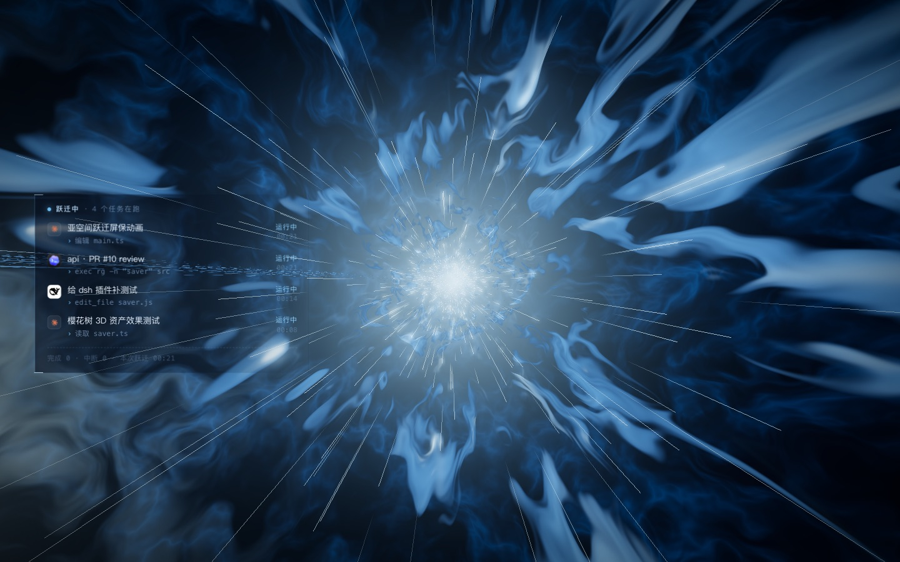
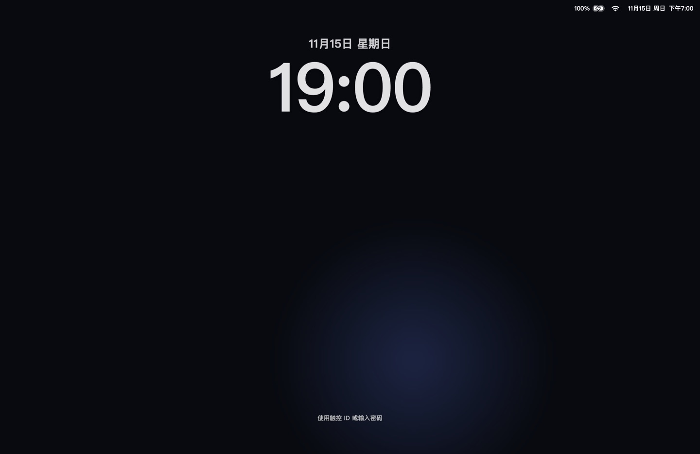

# dsh-screensaver：让 AI agent 在你离开时继续工作的 macOS 屏保

起身倒杯水、开个会、出门吃饭，Claude Code、Codex、DeepSeek Harness 这些 AI coding agent 还在跑，屏幕却不想让人看见。
dsh-screensaver 就是为这种时候做的：样子跟 Mac 锁屏一样，回来摸一下 Touch ID 就解开；屏保期间电脑不睡、屏幕不黑，
合上盖子也可以不睡；主题还能实时显示每个 agent 会话在跑、在等你确认，还是已经结束。

它是 [DeepSeek Harness](https://github.com/deepseek-ai/deepseek-harness)（dsh）插件，不装 dsh 也能用 `npx` 单独运行。

[English](README.md) · [llms.txt（写给 AI 看的简介）](llms.txt) · [主题开发](docs/themes.md) · [视觉素材授权](LICENSE-ASSETS.md)



| 时钟（内置） | 亚空间跃迁（独立主题包） |
| --- | --- |
|  | 用 three.js 画的跃迁隧道（见上图）。有 agent 在跑就进入亚空间，左侧列出每个会话，用各家产品自己的图标区分。亚空间里在星云雷暴、浪涌龙卷、高斯粒子三种画风之间自然切换。 |

## 和系统锁屏、系统屏保、动态壁纸有什么不同

系统锁屏和屏保默认你走开后电脑就该歇着；dsh-screensaver 假定 agent 还要继续干活，你只是不想让屏幕被人看见、被人碰。

| | 系统锁屏（⌃⌘Q） | 系统屏保 | 壁纸 / 动态壁纸 | caffeinate / Amphetamine | **dsh-screensaver** |
| --- | --- | --- | --- | --- | --- |
| 挡住路过的人 | 能，真正的系统锁 | 一碰就退出（勾了「需要密码」才会锁） | 不能 | 不能 | **能**（只是遮挡，不是安全措施） |
| 终端里的 agent（Claude Code、Codex CLI、dsh） | 照常运行 | 照常运行 | 照常运行 | 照常运行 | **照常运行** |
| computer use 类 agent、靠浏览器扩展驱动的 agent | 会停（[openai/codex#58545](https://github.com/openai/codex/issues/58545)、[openai/codex#43869](https://github.com/openai/codex/issues/43869)） | 未测试 | 照常 | 照常 | **浏览器扩展类照常运行**；需要点击屏幕的操作会被挡住 |
| 被盖住的浏览器窗口不降频 | 会降频，系统认为窗口不可见 | 未测试 | — | — | **不降频**：屏保保留了一点点透明度，系统仍认为窗口可见 |
| 不熄屏、不进入空闲睡眠 | 不管：锁屏后很快熄屏，之后睡不睡取决于其他程序（[anthropics/claude-code#81832](https://github.com/anthropics/claude-code/issues/81832)） | 不管 | 不管 | 管 | **屏保期间一直管** |
| 合盖不睡 | 不行 | 不行 | 不行 | 不行（防睡眠断言管不了合盖） | **默认开**，授权一次就生效（`pmset disablesleep`，退出后自动恢复） |
| 解锁 | Touch ID 或密码 | 按任意键（可能要输密码） | — | — | **直接摸 Touch ID**，或按键、点击后用 Touch ID / 登录密码 |
| 能看到 agent 在做什么 | 不能 | 不能 | 不能 | 不能 | **能**（支持会话的主题会显示名称、当前步骤和状态） |

在咖啡馆、办公室这类需要真正安全的地方，只跑终端 agent 的话用 ⌃⌘Q 更合适，需要合盖不睡可以先执行 `/screensaver lid on`。
在家临时走开，或者在跑 computer use、浏览器类 agent，就用 dsh-screensaver。

> dsh-screensaver 不是安全措施：长按电源键之类的操作拦不住，它也不能代替 macOS 登录密码。它防的是路过的人看到屏幕、碰到键盘。

## 安装

在 dsh 里使用：

```bash
dsh plugin --profile web add dsh-screensaver
```

DeepSeek Harness 桌面版把 `web` 换成 `desktop`。装好后重启 dsh。第一次启动会下载 Electron 运行时（约 100 MB，只下载一次）；
如果装了 Xcode 命令行工具，还会在本机编译 Touch ID 小程序。

主题单独安装，需要哪个装哪个。只用内置的「时钟」就不用装下面这个：

```bash
dsh plugin --profile web add dsh-screensaver-theme-subspace
```

想用 GitHub 上还没发布的最新代码，而不是 npm 上的发布版：

```bash
dsh plugin --profile web add github:realRoc/dsh-screensaver
dsh plugin --profile web add "github:realRoc/dsh-screensaver#path:/themes/subspace"
```

不装 dsh 也能用：

```bash
npx dsh-screensaver --now               # 立即开启，解锁后退出
npx dsh-screensaver                     # 在后台待命，按 ⌃⌥⌘L 开启
npx dsh-screensaver setup               # 改配置：合盖不睡（顺手授权）、主题、空闲自动开启
```

系统要求：macOS 12 及以上，Node.js 22 及以上。想「摸一下就解锁」，需要带 Touch ID 的 Mac（或带 Touch ID 的妙控键盘），
并装好 Xcode 命令行工具（`xcode-select --install`）；条件不满足时会改用系统的 Touch ID / 密码验证框。

## 使用

- **开启**：按 ⌃⌥⌘L；在 dsh 里输入 `/screensaver`；或者直接对 agent 说「我走开一下，帮我把屏幕盖上」，它会调用 `screensaver` 工具。也可以设置空闲几分钟后自动开启。
- **解锁**：摸一下 Touch ID。按任意键或点一下鼠标，会弹出系统验证框，可以用 Touch ID 或登录密码。
- **纯享模式**：30 秒没有操作，底部提示、右上角状态栏和会话列表会淡出，只留下动画；动一下鼠标、按个键或摸 Touch ID 就会重新出现。

| 命令 | 作用 |
| --- | --- |
| `/screensaver` | 用默认主题开启 |
| `/screensaver <主题>` | 用指定主题开启，例如 `/screensaver subspace` |
| `/screensaver themes` | 查看已安装的主题 |
| `/screensaver lid` | 查看合盖不睡的状态 |
| `/screensaver lid authorize` | 授权合盖不睡：输入一次管理员密码，安装一条只允许 `pmset -a disablesleep 0/1` 的 sudoers 规则 |
| `/screensaver lid on` / `off` | 手动打开或关闭合盖不睡 |
| `/screensaver lid revoke` | 撤销授权，删除这条规则 |

### 配置

在 `~/.dsh/profiles/<profile>/cordis.patch.yml` 里加一段（会整段替换默认配置）：

```yaml
- id: dsh-screensaver
  config:
    theme: subspace      # 默认主题
    idleMinutes: 10      # 空闲 10 分钟自动开启；0 表示不自动开启（默认）
    lidAwake: true       # 开启屏保时顺便打开合盖不睡（默认开，写 false 关掉）
    shortcut: Control+Alt+Command+L   # Electron 快捷键写法；填 '' 不注册快捷键
```

单独运行时，同样几项存在 `~/.dsh/plugins-data/dsh-screensaver/config.json`：

| 命令 | 作用 |
| --- | --- |
| `dsh-screensaver setup` | 一问一答：合盖不睡（当场授权）、主题、空闲自动开启 |
| `dsh-screensaver config` | 查看配置和配置文件位置 |
| `dsh-screensaver config <项> <值>` | 改一项，例如 `config lidAwake off`、`config idleMinutes 10` |
| `dsh-screensaver config unset <项>` | 改回默认 |
| `dsh-screensaver lid [status\|authorize\|revoke]` | 合盖不睡授权，同 `/screensaver lid` |
| `dsh-screensaver themes` | 查看已安装的主题 |

`DSH_SCREENSAVER_CONFIG='{"theme":"subspace"}'` 只对这一次生效，盖过配置文件。`--now` 交给已经在跑的屏保（比如 dsh 里那个）时，
会把这次的 `lidAwake` 一起带过去。

## 主题

| 主题 | id | 安装方式 | 显示 agent 会话 |
| --- | --- | --- | --- |
| 时钟 | `basic` | 内置 | 否 |
| 亚空间跃迁 | `subspace` | `dsh-screensaver-theme-subspace` | 是 |

更多主题陆续推出。每个主题就是一个文件夹：`index.html` 负责绘制（运行在沙盒 iframe 里），`saver.json` 写名称等信息。
自己做的主题放进 `~/.dsh/plugins-data/dsh-screensaver/themes/<id>/` 就能用，也可以发布成 npm 包，在 `package.json` 里写上
`"dsh-screensaver": { "theme": "." }`。详见 [docs/themes.md](docs/themes.md)。

## 能识别哪些 agent 会话

只有声明了 `"sessions": true` 的主题才会收到会话信息，而且只在屏保开启时读取。每 2 秒读一次本机文件，不联网，不上传任何数据。

| Agent | 读取位置 | 怎么判断在运行 / 等你确认 |
| --- | --- | --- |
| Claude Code | `~/.claude/sessions/<pid>.json`、`~/.claude/projects/**.jsonl` | 进程存活且状态为 busy；请求权限或等待输入时算「等你确认」 |
| OpenAI Codex | `~/.codex/sessions/年/月/日/rollout-*.jsonl`、`~/.codex/session_index.jsonl` | 最后一个 `task_started` 之后没有 `task_complete` / `turn_aborted` |
| DeepSeek Harness | `$DSH_HOME/sessions/*/*/session.v4.jsonl.zstd` 和 `session.lock` | 有 dsh 进程持有会话锁，且最后一个 `turn/start` 之后没有 `turn/end`；有未处理的 `approval/asked` 或未回答的 `ask_user_question` 时算「等你确认」 |

主题用各家产品自己的图标区分会话（Claude 的标志、Codex 的 App 图标、DeepSeek Harness 的鲸鱼）。这些图标是各公司的商标，这里只用来标明会话来自哪个产品。

## 常见问题

**屏保开着的时候，Claude Code / Codex / DeepSeek Harness 会话会停吗？**
不会。终端里的 agent 完全不受影响，电脑不会空闲睡眠，屏幕也不会熄灭。

**合上 MacBook 盖子还能继续跑吗？**
可以，授权一次就行：dsh 里执行 `/screensaver lid authorize`，单独运行时执行 `dsh-screensaver lid authorize`（或 `setup`）。
`lidAwake` 默认开，之后每次开屏保都会合盖不睡；不想要就设 `lidAwake: false`。
建议插着电源；用电池且电量降到 20% 时会自动恢复睡眠。

**能代替 macOS 锁屏吗？**
不能。它适合在家或办公室临时走开、又想让 agent 继续工作的场景。需要真正的安全保护时，请用 ⌃⌘Q。

**一定要装 DeepSeek Harness 吗？**
不用。`npx dsh-screensaver` 可以单独运行。装在 dsh 里会多出 `/screensaver` 命令、agent 可调用的工具和配置项。

**支持 Windows 或 Linux 吗？**
暂时只支持 macOS。

**会上传数据吗？**
不会。它只读取本机的会话文件和系统状态，不发任何网络请求（第一次运行时下载 Electron 除外）。

## 开发

```bash
git clone https://github.com/realRoc/dsh-screensaver && cd dsh-screensaver
npm install
npm test                       # 运行测试（vitest）
npm run now                    # 立即开启屏保试一下
npm run build:themes           # 修改 themes/subspace/src 后重新打包 index.html
DSH_SCREENSAVER_DEBUG=1 npm run now   # 打印页面里的 console 输出
```

### 发版

推送 `v*` 标签会触发 [`.github/workflows/publish.yml`](.github/workflows/publish.yml)：跑测试，再通过 Trusted Publishing（不用令牌）
把两个包发到 npm。某个包的版本 npm 上已有就跳过。

1. 改 `package.json` 的 `version`（主题有改动才改 `themes/subspace/package.json` 的版本）。
2. 提交并推送到 `main`。
3. 打标签并推送：`git tag vX.Y.Z && git push origin vX.Y.Z`。标签必须和根目录 `package.json` 的版本一致。

## 授权

代码采用 MIT；所有主题（`themes/`）和截图（`docs/images/`）等视觉素材采用 **CC BY-NC-SA 4.0，禁止商用**。
详见 [LICENSE-ASSETS.md](LICENSE-ASSETS.md)。

<!-- 关键词：AI agent 屏保，Claude Code 离开时继续运行，Codex 后台运行不休眠，Mac 防休眠，合盖不睡，Mac 合盖继续运行，
锁屏替代，Touch ID 解锁屏保，DeepSeek Harness 插件，dsh 插件，agent 会话监控，AI 编程助手挂机，caffeinate 替代，
Amphetamine 替代，macOS screensaver for AI coding agents -->
