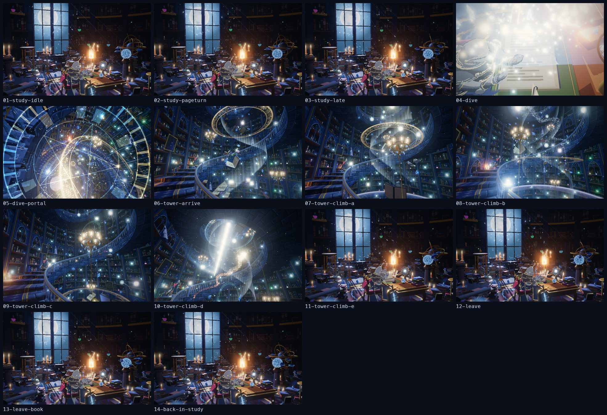
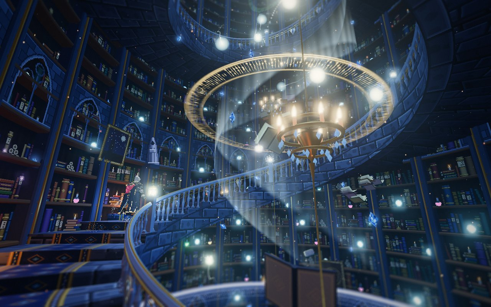
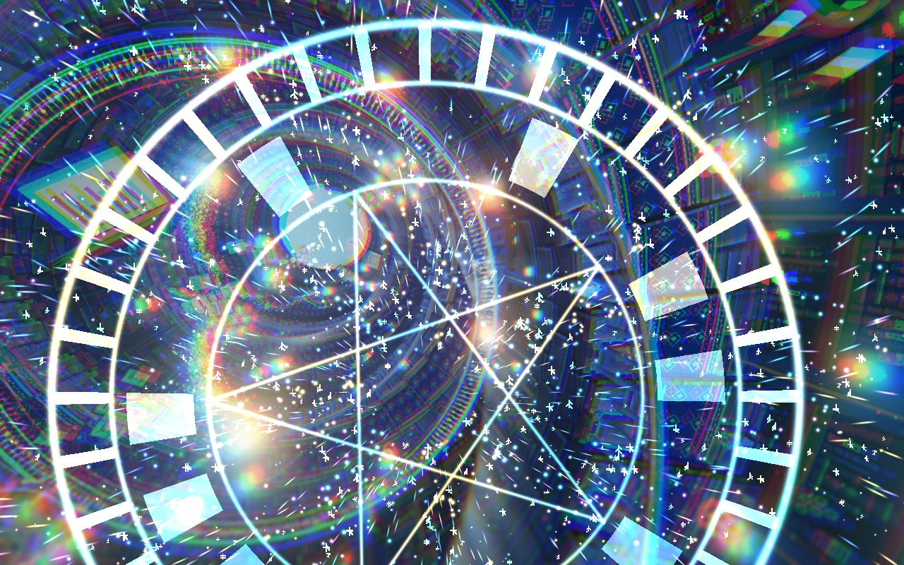

# 魔法书斋 · 现状审计（对照《Pixel Magic》视觉圣经 v0.2）

> 审计对象：`themes/magic-tower` @ 0.4.6（origin/main `40986f5`）。规则见 [BIBLE.md](BIBLE.md)。
> 每个元素都写了 `文件:行号`（`src/` 下）。结论用这几种：
> **保留** · **强化**（为主角多做一点）· **睡着**（书房：不自发光、压暗，转场时醒来）·
> **编排**（塔：改方向 / 对节拍 / 挪位置，让它跟着骑士上升）· **改事件**（从常驻改成事件里才亮）·
> **转场里放开** · **删代码**。
>
> 按 11-25 的决定：书房不减道具；塔要光怪陆离；转场要炸。所以这份审计几乎不「砍」，而是**重新分配光、方向和时机**。

---

## 1. 现状一眼看

`npm run style` 对 11 个关键帧的测量（1280×800，录制模式，《星井》驱动的特效）：

| 帧 | 幕 | 平均亮度 | 过曝 hi% | 独立亮点 lights | 金色 gold% | 饱和 | 碎度 edges% |
|---|---|---|---|---|---|---|---|
| 01 书房待机 | 静 | 0.21 | 0.86 | **40** | 1.75 | 0.41 | **4.67** |
| 02 书房翻页 | 静 | 0.21 | 0.83 | **44** | 1.67 | 0.41 | **4.71** |
| 03 书房（稍后） | 静 | 0.21 | 0.88 | **40** | 1.69 | 0.41 | **4.75** |
| 04 扎进书页 | 转场 | 0.72 | 34.1 | 155 | 0.39 | 0.11 | 1.00 |
| 05 传送门 | 转场 | 0.36 | 5.5 | 505 | 0.62 | 0.43 | 7.55 |
| 06 刚进塔 | 动 | 0.23 | 0.77 | 40 | 0.26 | 0.50 | 3.49 |
| 07 爬塔 a | 动 | 0.22 | 0.79 | 57 | 0.38 | 0.51 | 3.75 |
| 08 爬塔 b | 动 | 0.27 | 1.51 | 61 | 0.06 | 0.47 | 2.68 |
| 09 爬塔 c | 动 | 0.22 | 0.74 | 46 | 0.15 | 0.49 | 2.61 |
| 10 爬塔 d（巨剑落下） | 动 · 大事件 | 0.30 | 3.14 | 62 | 0.04 | 0.38 | 2.46 |
| 11 回书房 | 转场 | 0.39 | 9.9 | 87 | 0.01 | 0.37 | 1.58 |

粗体 = 超出圣经 §6 的目标（书房：亮点 ≤ 15、碎度 ≤ 4%；塔：无大事件时过曝 ≤ 3%）。转场和大事件只记录不判。
现状只有书房三帧不达标；塔的问题（骑士被淹没、方向乱）要等骑士遮罩加进检查后才量得出来。

### 结论

1. **书房不静**：40–44 个独立亮点同时发光——几十根蜡烛的火苗、辉石簇、宝箱、浑天仪核心、月亮周围的光点和尘埃。满屋子的道具都「醒着」，月光下读书这件事被淹没了。问题不在道具多，而在**它们都在发光**。
2. **塔够热闹，但不是围着骑士热闹**：
   - 骑士在 (0.27, 0.64)，深蓝盔甲贴着深色书墙，身上没有轮廓光，身后就是自发光的书墙——他是画面里最难找的东西；
   - 画面中心常驻着最亮的东西（吊灯、符文环、浑天仪），它们和骑士无关；
   - 动态方向各自为政：精灵乱窜、彗星从中心往四面射、飞书绕圈、余烬旋流，读不出「一起上升」。
3. **金色不是问题**：只占 0.04–1.75%。
4. **两幕不是一种画**：书房是真像素（约 520 行再放大）；塔是高清渲染 + 移轴模糊 + 颗粒。
5. **转场已经很炸，但没有接住两边**：
   - 进塔：蓄力（书房道具醒来）只有一点辉石涌动；爆发很满；落地时镜头滚转俯冲进塔，传送门的旋转和塔的螺旋没有对上。
   - 回书房：书飞回来打开的动作很好，但回到书房时还有残余粒子，「静」没有落下来。

---

## 2. 书房 · 静之美（study.js）

**做法：道具一样不减；光只留月光和书桌烛台；其余的都「睡着」，进塔时一起醒。**

| 元素 | 位置 | 结论 | 怎么改 |
|---|---|---|---|
| 骑士（坐姿） | :636 | **强化** | 加窗侧冷色轮廓光；身后半个身位压暗成「安静区」 |
| 书桌 + 椅子（Blender GLB） | :598-633 | **保留** | 已经是圣经要的画法 |
| 主书、手里那页、翻页池 | :649-690 | **保留** | |
| 书上的光（bookGlow / bookLight） | :706-707 | **保留** | 平时很弱，转场时亮 |
| 书桌烛台（3 臂 4 烛） | :716 | **强化** | 它就是主角的暖光：`candleLight` 绑到它身上，照亮骑士、书、书桌一圈 |
| 长窗 + 窗外天空 + 月亮 | :207-279 | **保留**（主光源） | 月亮光晕（:283）减半，不能比骑士抢眼 |
| 月光体积光 + 窗格投影 | :946, :1098 | **强化** | 这是「静」的灵魂：光束更清楚，窗格影子落在骑士和书桌上 |
| 月亮符文环 ×2、环绕光点 240 + 碎晶 60 | :299, :305 | **睡着** | 几乎看不见；进塔转场时亮起来转起来 |
| 光束里的尘埃 650 + 碎晶 90 | :971 | **保留** | 只在光束里亮，慢慢落——这是书房唯一的「动」 |
| 房间尘埃 520 | :1002 | **睡着** | 光束外的不亮 |
| 蜡烛 ~48 根 | :886-898 | **睡着** | 都留着；书桌一圈和窗台的点着，其余**熄灭**（留烛泪、去火苗），或火苗压到辉光阈值以下 |
| 落地烛台 ×3（各带点光） | :766-768 | **睡着** | 留一个在主角身后当补光，其余熄灭；转场时一齐点亮 |
| 辉石簇 ~45 簇 + 上升碎屑 | :900, :1050 | **睡着** | 平时不发光（只被月光照）；进塔时的「涌动」保留并加强 |
| 宝箱（内部发光 + 点光）、小匣子 ×3 | :765, :398 | **睡着** | 内光关掉，转场时开光 |
| 钥匙 ×4、沙漏 ×4、散页 ×16、盾 | :373, :799, :875, :747 | **保留** | 压在色阶 0–2 档 |
| 剑（立在桌边） | :756 | **睡着** | 辉光槽平时关；转场时第一个亮（它是爬塔时骑士手里的光） |
| 水晶球 ×2 + 环绕魔法石 ×7 | :421, :445 | **睡着** | 球不发光、石头不转；转场时转起来 |
| 浑天仪（桌上 + 地上 ×3）、吊顶地球仪、星盘 | :730, :819, :923, :462 | **睡着** | 核心和星盘的符文盘不发光、转速放慢到几乎不动；转场时加速 |
| 半身像（眼睛发光） | :453 | **睡着** | 眼睛平时不亮 |
| 地板、地毯、书墙、壁柱、墙上金环 | :177-203 | **保留，压暗** | 地毯的洋红 + 浅蓝降饱和；书墙贴图的发光像素去掉；金环暗金（离主角远） |
| 地上的书堆、书山（约 600–900 本） | :909-919 | **保留，压暗** | 数量不变；离书桌远的压在 0–2 档，读成一层厚厚的质感；碎度靠这个降 |
| 书上的符文漩涡 900 + 书页爆散 90 | :1027, :1086 | **转场里放开** | 两个都要，作为爆发的主体 |
| 月光阴影 | :1087 | **保留** | |

## 3. 爬塔 · 动之美（scene.js）

**做法：光怪陆离都留着，但让它们跟骑士站在一起——往上流、踩拍子、天井当舞台、骑士身边留安静区。**

### A. 常驻动态

| 元素 | 位置 | 结论 | 怎么改 |
|---|---|---|---|
| 浑天仪（金环 ×3 + 符文带 + 行星 + 核心 + 光晕） | :1424-1476 | **编排** | 留在天井，平时是暗金剪影、慢转；事件（脉冲、流星雨）时点亮。它在画面中心，平时不能是最亮的 |
| 符文环 ×4 | :1481 | **编排** | 改成沿螺旋上升（现在是各自旋转 + 摆动）；颜色统一成当前段落的一族魔法色；亮度平时降一级，拍点上闪一下 |
| 飞书 34 本 | :1500 | **编排** | 顺着骑士的方向绕天井往上飞；扇翅频率对齐拍子（现在 7–12 Hz 太碎） |
| 漂浮碎晶 44 | :1542 | **编排** | 沿螺旋缓缓上升 |
| 精灵 12 只 + 拖尾 | :1614 | **编排** | 从乱窜改成「领路」：在骑士前方几级台阶处往上飞，拖尾指向他要去的方向；颜色收成一族 |
| 粒子蛇 ×2 | :1689 | **保留** | 它们本来就是绕天井往上的螺旋，正是「动之美」的样子；确认旋转方向和楼梯一致 |
| 环境彗星（每 0.6–1.8 秒） | :2676 | **编排** | 方向改成从下往上、顺螺旋划过天井（现在从中心往四面射）；发射对齐拍子 |
| 尘埃 / 余烬 3600 | :1782 | **编排** | 整体往上漂（像被上升气流带着）；红余烬保留但只在骑士剑光附近 |
| 飘落书页 12 | :1820 | **编排** | 改成往上飘的书页（和「上升」一致），或保留下落作为对比——先试上升 |
| 辉石火花 1375 | :1327 | **保留** | 往上升，已经对了 |
| 剑上滴落的辉光 140 | :1994 | **强化** | 骑士自己的光，托出他的轮廓 |
| 脚步辉光 | :2930 | **强化** | 对齐拍子，每一步都在台阶上留一点光，形成跟着他的光迹 |
| `swordTipGlow` | :1990 | **删代码** | 从不显示 |

### B. 建筑和陈设

| 元素 | 位置 | 结论 | 怎么改 |
|---|---|---|---|
| 天空（星云、红橙云、星、月） | :837 | **保留** | 只在塔顶开口里看得到，正好是「上方」的目标 |
| 书墙 | :903 | **压暗** | 贴图自发光 ×1.6 → ≤ 0.4：骑士就在书墙前，书墙不能比他亮；药瓶的光留着（光怪陆离），但骑士身后半个身位内压暗 |
| 书架板、拱廊、立柱、黄铜肋、栏杆柱、扶手 | :913-1070 | **保留** | |
| 台阶、地毯 | :1031-1032 | **强化** | 地毯金边是指向骑士的引导线：骑士附近的亮，远处随雾变暗 |
| 扶手盾牌 ×176、金色镂空饰带 | :1106, :1130 | **保留** | 宝石光平时弱，扶手流光（chime）经过时一颗颗亮起 |
| 台阶蜡烛 88 + 墙边烛堆 | :1143-1206 | **保留** | 火苗节奏随拍子轻微起伏（现在是各自随机闪） |
| 栏杆灯柱 44 盏 | :1158 | **编排** | 灯球降出辉光核心；骑士经过时身边那盏亮一下（他走过的路被点亮） |
| 吊灯 24 盏 | :1347 | **编排** | 挂在天井中央、正对画面中心：平时火苗暗、坠饰暗金；大事件时整串亮起 |
| 辉石簇 1397 颗、油画、雕像、书堆 | :1230-1317 | **保留** | |
| 塔顶冠 | :1395 | **保留** | |

### C. 环境事件（无音乐时每 6–11 秒一个）

| 元素 | 位置 | 结论 |
|---|---|---|
| 光之巨剑 + 弧光 + 冲击波 | :2019-2063, :2797 | **保留**：系列的高潮符号 |
| 光柱、魔法阵、闪光、书墙扫光、极光、扶手流光、脉冲、流星雨 | :2175-2492, :2827-2841 | **保留**，落点量化到内部节拍器的强拍 |
| `hit()` 闪白 + 抖镜头 | :2157 | **保留闪白**；抖镜头改成只抖特效层、不抖镜头（圣经：不运镜） |
| 随机事件池（6–11 秒） | :2705, :2789 | **保留**；加上会话完成 / 等待 / 中断在场景里的小回应（圣经 §5） |

## 4. 转场 · 绚丽的过渡

| 元素 | 位置 | 结论 |
|---|---|---|
| 书房镜头推进书里 | study.js:1136 | **保留** |
| 书房涌动（辉石、水晶球、魔法石、灯） | study.js:1176-1201 | **强化**：这就是「蓄力」——所有睡着的道具（§2）一齐醒来：蜡烛点亮、宝箱开光、浑天仪加速、剑的辉光槽亮起 |
| 快速翻页 + 符文漩涡 + 书页爆散 | study.js:1027-1168 | **转场里放开** |
| 屏幕空间符文粒子 4200 + 魔法阵叠加 | scene.js:3102, :3163 | **转场里放开** |
| 传送门擦除（双环 + 光晕 + 符文 + 缩放模糊 + 色散） | scene.js:3028 | **保留并对齐**：传送门的旋转方向 = 塔的螺旋方向，让爆发直接「拧」进塔 |
| 全屏闪白 | scene.js:3289, :3298 | **保留**（允许过曝） |
| 进塔俯冲镜头（滚转 2.4 rad、fov 94 → 72） | scene.js:3237 | **改**：滚转方向和螺旋一致，落地时骑士已经在走 |
| 回书房：书飞来打开 + 暖光 + 书页爆散 | scene.js:3199-3222 | **保留**；回到书房最后 1 秒不再有新的爆发，道具依次「睡回去」 |

## 5. 渲染和后期

| 项 | 现状 | 结论 |
|---|---|---|
| 塔的渲染分辨率 | 像素比 ≤ 1.25（高清） | **回到约 520 行像素网格**；特效在 2 倍网格上（圣经 §1.2） |
| 移轴模糊 | 两幕都有（scene.js:2504） | **去掉**，远近改用雾和明度（圣经 §1.3） |
| 颗粒噪点 | ±0.006 | **去掉**；大块渐变用有序抖动 |
| 调色、暗角 | 有 | **保留** |
| 辉光 | 塔 0.7 / 阈值 0.85，书房 0.42 / 0.9 | 只给辉光色阶和火焰；常驻灯球降出辉光核心 |
| 曝光 | 塔 1.25、书房 0.95 | 先统一到一个基准，再按幕微调 |

## 6. 没用的代码（重构时顺手删）

- `makeKnightFrames`（scene.js:456）：从没调用。
- `swordTipGlow`（scene.js:1990）：从不显示。
- 书房 `floaters`（study.js:1074）：数量是 0。
- 代码画的备用书桌、椅子（study.js:478-550）：用不到。
- `armGlow.scale.setScalar(7)`（scene.js:1477）：每帧被覆盖。

---

## 7. 重构顺序

1. **主角托出来**（两幕）：轮廓光 + 身后安静区 + 身边暖光。改动小，最直接回应「画面为主体负责」。
2. **书房入睡**：道具不发光、远处蜡烛熄灭、月光束强化。目标亮点 ≤ 15。
3. **转场蓄力**：进塔时睡着的道具一齐醒来；传送门旋转方向对齐螺旋。
4. **塔的编排**：内部节拍器 → 所有动态往上、对拍 → 中心常驻物平时变暗、事件时点亮。
5. **塔回到像素网格 + 后期统一**（移轴、颗粒去掉）：视觉变化最大，单独一步做。
6. **风格检查补上骑士遮罩**：主角覆盖率、对比排名。

每一步都跑 `npm run style`，并录一段配《星井》的视频给你看。

---

## 8. 重构进度

### 第 1 步 · 主角托出来（11-25）

- **轮廓光**：骑士精灵着色器加了一盏「身后的光」——侧对镜头、又朝着这盏光的像素往亮里挪 1–2 档并染冷色；外描边那一圈不动，所以是描边里面紧贴的一条亮线。书房的光从长窗（`moonSpot`）来，扎进书页时减弱；塔里从塔顶开口（月光方向）来。`scene.js` `setKnightRim`。
- **安静区**：主角身后一张对着镜头的柔边暗片（`makeQuietZone` / `placeQuietZone`），书房在他身后 0.7 m、塔里 0.9 m；深度测试挡着，只压暗他身后更远的东西。
- **暖光**：书房书桌烛台照骑士的强度 0.4 → 0.75。塔里沿用最近一根蜡烛（1.1）。
- **风格检查补上了主角两项**：`rank`（骑士外接框的局部对比在全画面排第几）和 `ring`（他身后一圈 ÷ 他自己的平均亮度）。外接框来自 `magicTower.knightRect()`。

| 帧 | rank 前 → 后 | 说明 |
|---|---|---|
| 书房 01–03 | 13 → 14 | 几乎没动：书房里抢他的不是身后，而是脸旁边那组烛台的辉光——这是第 2 步（道具睡着）要解决的 |
| 塔 06 刚进塔 | 98 → 64 | |
| 塔 07 爬塔 a | 78 → 72 | |
| 塔 08 爬塔 b | 102 → 91 | |
| 塔 09 爬塔 c | 57 → 53 | |

塔里有改善但离目标（前 3）很远：画面中心常驻的吊灯、灯球、符文环仍然更抢眼，要等第 4 步（塔的编排）。接缝检测通过。

### 第 2 步 · 书房入睡（11-25）

- **一个 `awake` 系数管全屋**：取进塔转场的 `pose.surge`（扎进书页 0.2–1.3 秒里 0 → 1，回书房时 1 → 0）。所有自发光的小东西都登记在 `sleepers` 里（`glowBasic`、`halo` 两个工厂函数自动登记），睡着时只剩 10–15% 的亮度，醒来时回到原样。
- **睡着的**：宝箱的内光和点光、落地烛台的点光、辉石（自发光 0.28 → 0.03）、水晶球（含边缘辉光）、环绕水晶球的魔法石（几乎停住）、半身像的眼睛、桌上小星辉仪的核心、剑的辉光槽、盾的宝石、星盘的符文盘（转速放慢）、月亮的符文环和环绕光点。
- **蜡烛**：一根不少，书桌上那座三枝烛台和窗台上的点着，其余熄着（有烛泪、没火苗）；转场时按随机先后一根根点亮。火苗亮度 0.5 → 0.3：照亮他，但不比他抢眼。
- **月亮**：光晕减半；它仍然是主光，盘面清楚。
- **地毯**：底色压一档，跳的浅蓝改成暗蓝。
- **风格检查的主角排名改了口径**：只和不含光源（没有亮度 > 0.95 的像素）的格子比——光源本身可以比他亮，圣经要的就是光照着他。

| 帧 | 亮点 | 过曝 | 主角排名（新口径） |
|---|---|---|---|
| 书房 01–03 | 38–44 → **12–13**（目标 ≤ 15，达标） | 0.87% → 0.54% | 6–7 |

剩下比他抢眼的格子基本都是月光照着的长窗（月亮盘面没到 0.95 的门槛，所以没被当成光源排除），外加左下一格。月亮是这一幕的主光，先不动。碎度仍是 4.7%（目标 4%）：暗处的书堆、道具内部对比还在，后面「回到像素网格 + 统一后期」那一步再一起压。

转场：扎进书页的头 1 秒里，睡着的道具一起醒来（辉石先亮、蜡烛一根根点着、魔法石转起来），这就是圣经 §4 说的「蓄力」。接缝检测通过。

### 第 3 步 · 转场：蓄力和螺旋（11-25）

- **蓄力**：第 2 步的 `awake` 已经让书房在扎进书页的头 1 秒里醒来（辉石、蜡烛、魔法石、宝箱、星盘），这一步不再另加。
- **一个方向转**：塔的螺旋在画面上是顺时针盘上去的，转场里所有会转的东西都跟它一个方向——
  - 传送门：撕裂的边缘、两道光环、符文刻度、吸入的漩涡全部顺时针（以前第二道光环反着转、边缘不转）；
  - 符文爆散：以前每颗符文随机正转或反转，四散开；现在全部顺时针旋出去，是一个漩涡；
  - 魔法阵叠加：内圈符文从反转改成同向；
  - 回书房时全部反过来（逆时针「松开」）。
- **落地**：俯冲镜头的翻滚以前绕世界坐标轴滚，画面上往哪边转取决于骑士当时在塔的哪个角度；现在绕镜头自己的视线滚，画面总是顺时针转着落定。落地时骑士已经在走（塔从进塔第 1.2 秒就开始更新）。
- **归静**：回书房的最后一个新效果在第 2.4 秒（共 4 秒），之后书房的道具按随机先后睡回去，没改。

转场本身的「炸」（闪白、色散、满屏魔法阵）按 11-25 的决定保留不动。接缝检测通过。

### 第 4 步 · 塔的编排（11-25）

- **内部节拍器 = 骑士的步子**：步速 1.3 → 1.2 步 / 秒，正好是《星井》♩=72 的一拍一步；三步一小节。每一步落地就是一拍。
  - 没放音乐时：流星每一拍有一半机会放一颗（以前是 0.6–1.8 秒随机）；环境大事件（剑、光柱、法阵、极光、脉冲、流星雨）仍然 6–11 秒一个，但落在小节的强拍上。
  - 符文环在每个强拍上轻轻亮一下。
- **方向统一：都顺着螺旋往上**（骑士走的方向，俯视逆时针）：
  - 第二条粒子蛇（金红）以前反着转，改成同向；
  - 飞书：一半书群以前反着绕，改成全部同向、全部往上飞；扇翅对拍（小书一拍一下，巨书两拍一下，以前 7–12 rad/s 随机）；
  - 精灵：方向统一、全部往上；
  - 漂浮碎晶：顺螺旋缓缓上升；
  - 符文环：绕竖轴的转向统一；
  - 书页：从往下落改成往上飘；
  - 流星：从横穿天井改成顺螺旋往上划一段弧。
- **中心留给事件**：新增 `stageU`（0 = 平时，1 = 事件正盛），由共鸣、光环闪、浑天仪脉冲和正在进行的大事件算出来，升得快、落得慢。
  - 浑天仪的核心、行星、符文带、光晕和它的 70 强度点光：平时 25%；
  - 吊灯的火苗：平时 30%；吊灯水晶坠：0.9 → 0.25；
  - 符文环：平时 30%。
- **他走过的路被点亮**：44 盏栏杆灯的灯球平时降出辉光核心（0.3 倍），骑士走近的那几盏亮起来、走过后慢慢暗回去。

| 帧 | 主角排名（不含光源的格子里） 第 2 步后 → 第 4 步后 |
|---|---|
| 塔 06 刚进塔 | 32 → 16 |
| 塔 07 爬塔 a | 40 → 28 |
| 塔 08 爬塔 b | 15 → 6 |
| 塔 09 爬塔 c | 24 → 10 |
| 塔 10 巨剑落下 | 9 → 3 |

（步速变了，同一时刻骑士站的位置不同，数字是趋势不是逐帧对比。）录制模式按《星井》的谱子放特效，事件几乎不停，所以中心物在录像里大部分时间是「亮」的；真屏保里没有音乐、6–11 秒一个事件，平时会更暗。目标「前 3」还差一截，剩下的主要是：画面中心的金色符文环和吊灯在事件期间仍然最亮、骑士身后书墙的药瓶光点。下一步回到像素网格时一起看。

### 第 5 步 · 塔回到像素网格，后期统一（11-25）

- **一条规则，两个数**：渲染行数按「骑士精灵一个像素对一格」定，再最近邻放大。书房坐姿精灵 152 px/m、骑士（1.55 m）占画面 45% 高 → 520 行（原来就是）；塔里走路精灵 43 px/m、骑士（1.9 m）占 13.3% 高 → **615 行**（原来是高清，像素比最高 1.25）。现在塔里的台阶、栏杆、书墙和骑士是同一种颗粒。
- **去掉移轴模糊**（两幕）：像素糊了就不是像素画；远近交给雾和明度。
- **去掉颗粒噪点**（两幕）：像素画里噪点读起来是脏。
- **保留**：调色（暗部偏青、亮部偏金）、暗角、辉光（在渲染分辨率上算、随画面一起放大）。
- **转场的合成和符文叠加仍在全分辨率**：动的东西比静的细，符合圣经 §1.2。
- **更快**：同一台机器 1280×800、像素比 2 的测量，塔 13–14 → 4.7 ms / 帧，书房 9 → 4.2 ms / 帧。

| 指标 | 第 4 步后 → 第 5 步后 |
|---|---|
| 书房碎度 edges% | 4.7 → 5.2（移轴不再糊掉前后景，边缘变清楚；目标 4% 要重新看——像素画天然边多，这个目标可能要按像素网格重定） |
| 塔主角排名 | 16 / 28 / 6 / 10 / 3 → 22 / 15 / 4 / 9 / 4 |

接缝检测通过。

### 第 6 步 · 风格检查补上「特效盖住主角」（11-25）

- **怎么量**：塔里的每个关键帧，同一时刻多画两张——`setDebugView({ fx: false })` 藏掉所有特效和光（叠加混合的、点云、精灵片），`{ knight: false }` 只藏骑士精灵（安静区、影子留着）。后者和原图不一样的像素就是骑士本人（遮罩）；遮罩里，前者和原图差超过 28/255 的就是「被特效盖住」。骑士自己的光（剑上滴落的辉光）标了 `knightOwn`，不算特效。两张图都存在 `scripts/out/style/<帧>-nofx.png`、`-noknight.png`，方便对着看。
- **第一次量就抓到问题**：爬塔 a 那一帧 16–53% 被盖住。对着看是**脚步辉光**——每一步在他靴子正前方放一团光，加上辉光，把小腿和靴子刷白了（一拍一步之后更频繁）。改成落在台阶上的一点小光（大小 0.2 → 0.11、亮度减半、往下挪到台阶面上）。
- **顺手**：环境尘埃和辉石火花进到骑士身体附近的椭球里会淡掉（`knightQuiet()`），圣经 §1.1「特效不从他身上穿过去」。

| 帧 | cover% 改前 → 改后 |
|---|---|
| 塔 06 | 1–2 → 1.2–1.4 |
| 塔 07 | 16–53 → **0–0.1** |
| 塔 08 | 0–1 → 0 |
| 塔 09 | 2–3 → 1.4–1.8 |
| 塔 10（巨剑） | 0 → 0 |

目标 ≤ 10%，全部达标。爬塔 a 的对比排名从 16 掉到 30：之前那团白光把他「刷亮」了，排名其实是假的。接缝检测通过。
